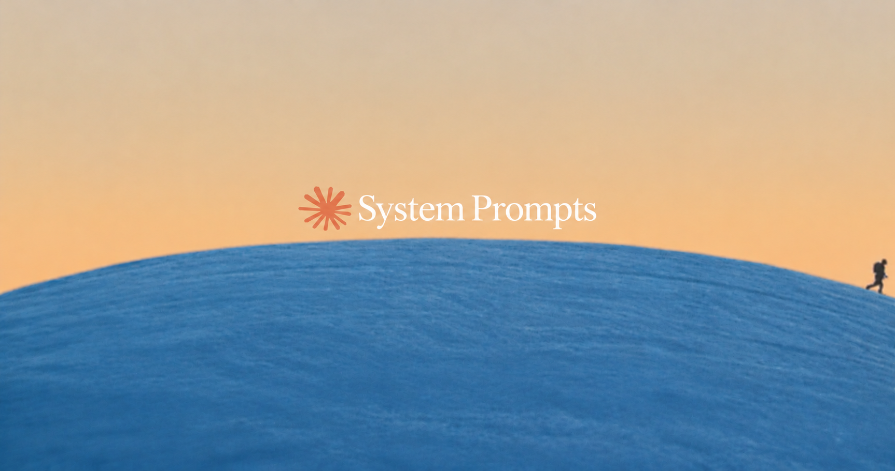

<div align="center">

# Claude System Prompts: Every Official Claude System Prompt in One Repo

### A verbatim, dated archive of all official Anthropic system prompts for Claude, from Claude Fable 5.2 back to Claude Haiku 3.



*Curated & Extracted by **[Sayan Chowdhury](https://github.com/saynchowdhury)***

[]()
[]()
[]()
[]()
[]()
[](https://github.com/KalarisLabs/claude-systems-prompts)

<br/>

[](https://twitter.com/intent/tweet?text=Every%20official%20Claude%20system%20prompt%2C%20verbatim%20and%20dated%2C%20in%20one%20open-source%20repo.%2023%20models%20from%20Fable%205.2%20to%20Haiku%203.&url=https://github.com/KalarisLabs/claude-systems-prompts)
[](https://www.linkedin.com/sharing/share-offsite/?url=https://github.com/KalarisLabs/claude-systems-prompts)
[](https://reddit.com/submit?url=https://github.com/KalarisLabs/claude-systems-prompts&title=Claude%20System%20Prompts%3A%20every%20official%20Claude%20system%20prompt%20in%20one%20repo)
[](https://news.ycombinator.com/submitlink?u=https://github.com/KalarisLabs/claude-systems-prompts&t=Claude%20System%20Prompts%3A%20every%20official%20Claude%20system%20prompt%20in%20one%20repo)
[](https://www.linkedin.com/in/sayanchowdhuryai/)

*All official Claude system prompts for claude.ai, the Claude iOS app, and the Claude Android app, plus original analysis of how Claude is engineered to think, refuse, write, and use tools.*

[Models at a Glance](#models-at-a-glance) | [Who Is This For?](#who-is-this-for) | [Key Revelations](#key-revelations) | [Full Fable 5 Prompt](system-prompt/full-system-prompt.md) | [Analysis](system-prompt/analysis/key-findings.md) | [Highlights](highlights/surprising-revelations.md)

</div>

---

## What Is This?

**Claude System Prompts** is the open-source home for every system prompt Anthropic publishes for its consumer Claude products. This repository archives **23 official Claude system prompts**: the full lineup, from Anthropic's newest Mythos-class models (**Claude Fable 5.2**) back to **Claude Haiku 3**. Every prompt is copied verbatim from [Anthropic's official release notes](https://platform.claude.com/docs/en/release-notes/system-prompts/overview), dated, and source-linked.

A system prompt is the instruction layer that shapes how an AI model behaves before you type anything. It encodes refusal policy, tone, formatting, tool use, safety architecture, and model-specific caveats. Anthropic now publishes these prompts for claude.ai and the Claude mobile apps. This repo collects all of them in one place, alongside original research, analysis, and tooling.

**What's inside:**

- **[`models/`](models/README.md)**: all 23 official system prompts, verbatim, with latest version dates, full version history per model, and direct links to the source page for every release
- **[`system-prompt/`](system-prompt/full-system-prompt.md)**: deep dive on the flagship, the complete ~1,580-line Claude Fable 5 system prompt, tool definitions, and multi-part analysis
- **[`highlights/`](highlights/surprising-revelations.md)**: the most surprising findings across the Claude prompt family
- **[`scripts/`](scripts/verify_signatures.py)**: integrity verification for the archive's curation chain

**Coverage:** 23 models, 50 published prompt versions referenced, July 2024 to November 2026, 100% verbatim from official Anthropic sources.

---

## Models at a Glance

Every archived prompt lives at `models/<model>/system-prompt.md`. Each file carries its latest version date, lists every version Anthropic has published on that model's page (newest first), and links the canonical source. See the full index with per-model version history in **[models/README.md](models/README.md)**.

| Model | Latest version | Archived prompt | Source (Anthropic) |
|-------|----------------|-----------------|--------------------|
| **Claude Fable 5.2** | November 9, 2026 | [system-prompt.md](models/claude-fable-5-2/system-prompt.md) | [platform.claude.com](https://platform.claude.com/docs/en/release-notes/system-prompts/claude-fable-5-2) |
| **Claude Haiku 5.5** | October 26, 2026 | [system-prompt.md](models/claude-haiku-5-5/system-prompt.md) | [platform.claude.com](https://platform.claude.com/docs/en/release-notes/system-prompts/claude-haiku-5-5) |
| **Claude Sonnet 5.5** | October 27, 2026 | [system-prompt.md](models/claude-sonnet-5-5/system-prompt.md) | [platform.claude.com](https://platform.claude.com/docs/en/release-notes/system-prompts/claude-sonnet-5-5) |
| **Claude Opus 5.5** | October 27, 2026 | [system-prompt.md](models/claude-opus-5-5/system-prompt.md) | [platform.claude.com](https://platform.claude.com/docs/en/release-notes/system-prompts/claude-opus-5-5) |
| **Claude Fable 5.1** | October 30, 2026 | [system-prompt.md](models/claude-fable-5-1/system-prompt.md) | [platform.claude.com](https://platform.claude.com/docs/en/release-notes/system-prompts/claude-fable-5-1) |
| **Claude Opus 5** | October 30, 2026 | [system-prompt.md](models/claude-opus-5/system-prompt.md) | [platform.claude.com](https://platform.claude.com/docs/en/release-notes/system-prompts/claude-opus-5) |
| **Claude Sonnet 5** | October 30, 2026 | [system-prompt.md](models/claude-sonnet-5/system-prompt.md) | [platform.claude.com](https://platform.claude.com/docs/en/release-notes/system-prompts/claude-sonnet-5) |
| **Claude Fable 5** | October 30, 2026 | [system-prompt.md](models/claude-fable-5/system-prompt.md) | [platform.claude.com](https://platform.claude.com/docs/en/release-notes/system-prompts/claude-fable-5) |
| **Claude Opus 4.8** | October 30, 2026 | [system-prompt.md](models/claude-opus-4-8/system-prompt.md) | [platform.claude.com](https://platform.claude.com/docs/en/release-notes/system-prompts/claude-opus-4-8) |
| **Claude Opus 4.7** | October 30, 2026 | [system-prompt.md](models/claude-opus-4-7/system-prompt.md) | [platform.claude.com](https://platform.claude.com/docs/en/release-notes/system-prompts/claude-opus-4-7) |
| **Claude Sonnet 4.6** | October 14, 2026 | [system-prompt.md](models/claude-sonnet-4-6/system-prompt.md) | [platform.claude.com](https://platform.claude.com/docs/en/release-notes/system-prompts/claude-sonnet-4-6) |
| **Claude Opus 4.6** | October 30, 2026 | [system-prompt.md](models/claude-opus-4-6/system-prompt.md) | [platform.claude.com](https://platform.claude.com/docs/en/release-notes/system-prompts/claude-opus-4-6) |
| **Claude Opus 4.5** | January 18, 2026 | [system-prompt.md](models/claude-opus-4-5/system-prompt.md) | [platform.claude.com](https://platform.claude.com/docs/en/release-notes/system-prompts/claude-opus-4-5) |
| **Claude Haiku 4.5** | October 23, 2026 | [system-prompt.md](models/claude-haiku-4-5/system-prompt.md) | [platform.claude.com](https://platform.claude.com/docs/en/release-notes/system-prompts/claude-haiku-4-5) |
| **Claude Sonnet 4.5** | January 18, 2026 | [system-prompt.md](models/claude-sonnet-4-5/system-prompt.md) | [platform.claude.com](https://platform.claude.com/docs/en/release-notes/system-prompts/claude-sonnet-4-5) |
| **Claude Opus 4.1** | August 5, 2025 | [system-prompt.md](models/claude-opus-4-1/system-prompt.md) | [platform.claude.com](https://platform.claude.com/docs/en/release-notes/system-prompts/claude-opus-4-1) |
| **Claude Opus 4** | August 5, 2025 | [system-prompt.md](models/claude-opus-4/system-prompt.md) | [platform.claude.com](https://platform.claude.com/docs/en/release-notes/system-prompts/claude-opus-4) |
| **Claude Sonnet 4** | August 5, 2025 | [system-prompt.md](models/claude-sonnet-4/system-prompt.md) | [platform.claude.com](https://platform.claude.com/docs/en/release-notes/system-prompts/claude-sonnet-4) |
| **Claude Sonnet 3.7** | February 24, 2025 | [system-prompt.md](models/claude-sonnet-3-7/system-prompt.md) | [platform.claude.com](https://platform.claude.com/docs/en/release-notes/system-prompts/claude-sonnet-3-7) |
| **Claude Sonnet 3.5** | November 22, 2024 | [system-prompt.md](models/claude-sonnet-3-5/system-prompt.md) | [platform.claude.com](https://platform.claude.com/docs/en/release-notes/system-prompts/claude-sonnet-3-5) |
| **Claude Haiku 3.5** | October 22, 2024 | [system-prompt.md](models/claude-haiku-3-5/system-prompt.md) | [platform.claude.com](https://platform.claude.com/docs/en/release-notes/system-prompts/claude-haiku-3-5) |
| **Claude Opus 3** | July 12, 2024 | [system-prompt.md](models/claude-opus-3/system-prompt.md) | [platform.claude.com](https://platform.claude.com/docs/en/release-notes/system-prompts/claude-opus-3) |
| **Claude Haiku 3** | July 12, 2024 | [system-prompt.md](models/claude-haiku-3/system-prompt.md) | [platform.claude.com](https://platform.claude.com/docs/en/release-notes/system-prompts/claude-haiku-3) |

> Note: These are the system prompts for claude.ai and the Claude mobile apps. They do **not** apply to the Claude API. When Anthropic publishes a newer version of any prompt, this repo is updated to match. See [Contributing](CONTRIBUTING.md).

---

## Who Is This For?

This repository is built for people who need the raw text itself.

### 🧑‍💻 AI & Machine Learning Engineers
Building on Claude (API, Bedrock, Vertex, MCP)? Study how Anthropic structures refusal handling, tone control, formatting policy, and tool-use contracts in production, then apply the same patterns in your own system prompts. Diffing two dated versions of the same model (for example [Claude Fable 5, June 9 vs October 30, 2026](models/claude-fable-5/system-prompt.md)) shows exactly how Anthropic iterates on behavior.

### 🛡️ AI Safety & Alignment Researchers
Primary source material for studying frontier refusal architecture: `<critical_child_safety_instructions>`, `<user_wellbeing>` crisis protocols, the `<anthropic_reminders>` classifier system, dual-use capability gating, and evenhandedness guidelines. Versioned across 23 models and 50 dated releases.

### 🔍 Security Researchers & Red Teamers
Analyze prompt-injection defenses, reminder-tag provenance rules, and data boundary enforcement. Understanding what the system prompt already forbids, and how, is the starting point for meaningful evaluation of agentic systems built on Claude.

### 🚀 Product Builders & Startup Founders
Shipping a Claude-powered product? Learn what claude.ai gives users out of the box: artifact conventions, the memory system, web search behavior, citation rules, and artifact API calls. Your own scaffolding will compose cleanly instead of fighting the base behavior.

### 🎓 Students, Educators & AI-Literacy Researchers
A citable, dated, primary source corpus for courses, papers, and policy work on how frontier AI assistants are behaviorally engineered.

### ✍️ Journalists & Tech Writers
The original documents behind the coverage. Quote Anthropic's own words. Trace how safeguards and capabilities evolved from Claude 3 (July 2024) to the Mythos-class Fable 5 line (November 2026). The archive is preserved here even as Anthropic's own pages change.

---

## Key Revelations

The Claude Fable 5 archive (extracted from a live claude.ai session) revealed how Anthropic engineers its flagship model. Highlights, with full context in [`system-prompt/`](system-prompt/full-system-prompt.md):

### Mythos-Class: A New Model Tier Above Opus

Claude Fable 5 belongs to a new "Mythos-class" model tier that sits above Claude Opus in capability. The prompt confirms:

> *"This iteration of Claude is Claude Fable 5, the first model in Anthropic's new Claude 5 family and part of a new Mythos-class model tier that sits above Claude Opus in capability."*

- **Claude Fable 5** and **Claude Mythos 5** share the same underlying model
- **Claude Mythos 5** is available without safety measures to **approved organizations only**
- Model strings: `claude-fable-5`, `claude-opus-4-8`, `claude-sonnet-4-6`, `claude-haiku-4-5-20251001`

### The Full Claude Product Ecosystem

The prompt reveals a large product lineup:

| Product | Description |
|---------|-------------|
| **Claude Code** | Agentic coding tool (CLI, desktop, mobile) |
| **Claude Cowork** | Agentic knowledge-work desktop app for non-developers |
| **Claude in Chrome** | Browsing agent |
| **Claude in Excel** | Spreadsheet agent |
| **Claude in PowerPoint** | Slides agent |

Claude Cowork can use all of the above as **tools**, making it a meta-agent that orchestrates other Claude agents.

### "Claudeception": API Inside Artifacts

Claude can make **Anthropic API calls from within Artifacts**, creating AI-powered interactive applications. The prompt uses Sonnet 4 as the internal model:

```javascript
model: "claude-sonnet-4-20250514" // Always use Sonnet 4
```

Claude can build applications that call Claude. A recursive AI architecture.

### 22+ Tools in the Arsenal

The prompt defines an extensive toolset including: `web_search`, `web_fetch`, `bash_tool`, `create_file`, `str_replace`, `image_search`, `places_search`, `places_map_display_v0`, `recipe_display_v0`, `ask_user_input_v0`, `message_compose_v1`, `suggest_connectors`, `search_mcp_registry`, `recommend_claude_apps`, `fetch_sports_data`, `weather_fetch`, `present_files`, and more.

### Aggressive Copyright Compliance

The prompt contains an extremely detailed copyright enforcement system with hard limits:
- **15+ words** from any single source = **SEVERE VIOLATION**
- **ONE quote per source MAXIMUM**: after one quote, that source is "CLOSED"
- **Default to paraphrasing**: quotes should be "rare exceptions"
- Never reproduce song lyrics, poems, or haikus in any form

### Self-Harm & Mental Health: Unprecedented Depth

The prompt includes detailed mental health guidelines:
- No substitution techniques that mimic self-harm (ice cubes, rubber bands, sour candy)
- No causal narratives for disordered eating the user hasn't made themselves
- Acknowledge bad experiences with crisis services without totalizing the system
- Never build over-reliance on Claude or push the user to keep talking

### Knowledge Cutoff: End of January 2026

Claude's reliable knowledge cutoff is **end of January 2026**, with the current date set to **June 9, 2026**.

---

## Repository Structure

```
claude-systems-prompts/
├── README.md                              ← You are here
├── LICENSE                                ← MIT License (prompt content © Anthropic, PBC)
├── CONTRIBUTING.md
├── models/                                ← ALL official Claude system prompts
│   ├── README.md                          ← Index of every model, version, and source
│   ├── claude-fable-5-2/system-prompt.md  ← verbatim + latest version date
│   ├── claude-fable-5-1/
│   ├── claude-fable-5/
│   ├── claude-opus-5-5/  claude-opus-5/  claude-opus-4-8/  ... claude-opus-3/
│   ├── claude-sonnet-5-5/ claude-sonnet-5/ claude-sonnet-4-6/ ... claude-sonnet-3-5/
│   ├── claude-haiku-5-5/  claude-haiku-4-5/  claude-haiku-3-5/  claude-haiku-3/
│   └── ...                                ← 23 models, 50 published versions indexed
├── system-prompt/                         ← Fable 5 deep dive (original analysis)
│   ├── full-system-prompt.md              ← Complete formatted system prompt
│   ├── tool-definitions.md                ← All 22+ tool schemas extracted
│   └── analysis/
│       ├── key-findings.md                ← Top discoveries and insights
│       ├── model-architecture.md          ← What we learn about the model stack
│       ├── behavioral-guidelines.md       ← Deep dive into behavior engineering
│       └── fable5-vs-opus-comparison.md   ← Mythos-class vs Opus-class comparison
├── highlights/
│   └── surprising-revelations.md          ← Most shocking/viral findings
├── scripts/
│   └── verify_signatures.py               ← Curation integrity validator
└── assets/
    └── system-prompts-hero.png            ← README hero banner
```

---

## Table of Contents: Fable 5 System Prompt

| Section | Description |
|---------|-------------|
| [`claude_behavior`](system-prompt/full-system-prompt.md#claude_behavior) | Core behavioral rules, product info, tone, formatting |
| [`memory_system`](system-prompt/full-system-prompt.md#memory_system) | Cross-session memory access |
| [`persistent_storage_for_artifacts`](system-prompt/full-system-prompt.md#persistent_storage_for_artifacts) | Key-value storage API for artifacts |
| [`mcp_app_suggestions`](system-prompt/full-system-prompt.md#mcp_app_suggestions) | MCP connector/app suggestion system |
| [`computer_use`](system-prompt/full-system-prompt.md#computer_use) | Skills, file handling, artifact creation |
| [`search_instructions`](system-prompt/full-system-prompt.md#search_instructions) | Web search behaviors and copyright compliance |
| [`using_image_search_tool`](system-prompt/full-system-prompt.md#using_image_search_tool) | Image search guidelines |
| [`Tool Definitions`](system-prompt/tool-definitions.md) | Complete schemas for all tools |
| [`anthropic_api_in_artifacts`](system-prompt/full-system-prompt.md#anthropic_api_in_artifacts) | "Claudeception": API-in-artifact system |
| [`citation_instructions`](system-prompt/full-system-prompt.md#citation_instructions) | Citation format and rules |
| [`network_configuration`](system-prompt/full-system-prompt.md#network_configuration) | Allowed domains and egress rules |

---

## How to Use This Repo

**Browse any model:** Start with **[models/README.md](models/README.md)**. It indexes every official Claude system prompt by model and version date.

**Read the flagship prompt:** [`system-prompt/full-system-prompt.md`](system-prompt/full-system-prompt.md) for the complete, formatted Claude Fable 5 system prompt with section anchors.

**Quick highlights:** Jump to [`highlights/surprising-revelations.md`](highlights/surprising-revelations.md) for the most interesting findings.

**Deep analysis:** The [`system-prompt/analysis/`](system-prompt/analysis) directory contains breakdowns of the model architecture, behavioral engineering, and a detailed [Fable 5 vs Opus 4.8 Comparison](system-prompt/analysis/fable5-vs-opus-comparison.md).

**Verify Integrity:** Run the signature checker to confirm your clone's content and curation attributions are original:
```bash
python scripts/verify_signatures.py
```

---

## Why This Matters

System prompts are the invisible architecture behind AI behavior. This archive reveals:

1. **How Anthropic engineers personality**: from warm tone requirements to anti-bullet-point philosophy
2. **The Mythos tier system**: a previously unknown model hierarchy above Opus
3. **Recursive AI architecture**: Claude calling Claude inside Artifacts
4. **Unprecedented safety nuance**: mental health guidelines more detailed than most clinical protocols
5. **The agentic future**: Cowork as a meta-agent orchestrating Claude Code, Chrome, Excel, and PowerPoint
6. **How safeguards evolve**: track `<user_wellbeing>` and refusal policy changes across 50 dated versions, from Claude 3 to Fable 5.2

This archive is the primary source document set for understanding how frontier AI models are shaped, and how that shaping changes over time.

## Fun Quirks & Valuable Learnings

Beyond the architecture, the prompt reveals some memorable rules that govern Claude's personality:

- **"Claudeception"**: Fable 5 is explicitly allowed to use the Anthropic API (via Sonnet 4) *from within* the interactive artifacts it generates.
- **The Anti-Bullet-Point Crusade**: The prompt aggressively bans Claude from using bullet points or bold text in standard prose, noting it wants to avoid looking like stereotypical "AI slop." It even notes: *"Claude never uses bullet points when declining a task; the additional care helps soften the blow."*
- **No Sycophantic Gratitude**: Claude is explicitly told to *never* thank the user just for reaching out, and to never beg the user to keep talking.
- **Military-Grade Copyright**: More than 15 words quoted from a single source is defined as a "SEVERE VIOLATION". The prompt includes a 5-step checklist Claude must run before quoting text.
- **Clinical Nuance**: It forbids suggesting "rubber bands or ice cubes" as self-harm substitutes, noting (like a graduate psychology textbook) that sensory substitutions reinforce neural pathways rather than breaking them.

For the full list of deep dives, see [`highlights/surprising-revelations.md`](highlights/surprising-revelations.md).

---

## Keywords & Topics

Claude system prompt, Anthropic system prompt, Claude system prompt archive, claude.ai system prompt, Claude Opus system prompt, Claude Sonnet system prompt, Claude Haiku system prompt, Claude Fable 5 system prompt, Claude Fable 5.2, Claude Mythos, Mythos-class model, Anthropic Claude behavioral guidelines, prompt engineering for Claude, AI safety research, frontier model system prompt, Claude API vs claude.ai prompts, open-source AI prompt archive

---

## Community & Contributing

We want to make this repository the premier research hub for Anthropic's Claude models.
Found a novel jailbreak, a behavioral quirk, a new prompt version, or want to add an interactive tool?

Please check our [Contributing Guidelines](CONTRIBUTING.md) and open an Issue using our templates, or submit a PR with your analysis. Community discussion is welcome.

### Contributors
[](https://github.com/KalarisLabs/claude-systems-prompts/graphs/contributors)

---

## Disclaimer

This repository is for **educational and research purposes**. The archived system prompts are the **intellectual property of Anthropic, PBC** and are reproduced verbatim from Anthropic's official release notes ([platform.claude.com](https://platform.claude.com/docs/en/release-notes/system-prompts/overview)). The Claude Fable 5 deep dive was extracted from a publicly accessible claude.ai session. All rights to the original content belong to Anthropic. This repo does not claim ownership of Anthropic's intellectual property.

---

## License

MIT. See [LICENSE](LICENSE) for details. The archived prompt text itself is Anthropic, PBC intellectual property and is not covered by the MIT grant. See the note in the LICENSE file.

---

<div align="center">

## Why Star This Repo? ⭐

This repository is updated as Anthropic ships new prompt versions. By starring it, you get:
- Real-time updates when Anthropic publishes a new or updated system prompt for any Claude model.
- Community-driven analysis and insights into frontier AI behavior.
- JSON schemas and tool structures you can reverse-engineer for your own AI agents.

---

**If you found this interesting, consider starring the repo!**

[](https://star-history.com/#KalarisLabs/claude-systems-prompts&Date)


*This repository is curated and maintained by **[Sayan Chowdhury](https://github.com/saynchowdhury)**. All rights to the original system prompt text are owned by Anthropic, PBC.*

</div>
